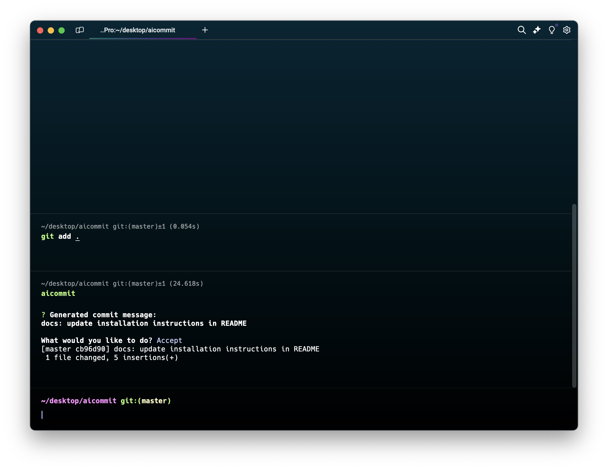

<h1 align="center">aicommit</h1>

<p align="center">
基于 AI 自动生成 Conventional Commits 提交信息与分支名的 CLI 工具。
</p>

## 安装

需要 Node.js >= 18。

```sh
npm install -g unique-aicommit
```

## 配置

内置支持的 Provider：

| Provider | 默认模型 | API Key 配置项 |
|----------|----------|----------------|
| `deepseek` | `deepseek-chat` | `DEEPSEEK_KEY` |
| `moonshot` | `moonshot-v1-8k` | `MOONSHOT_KEY` |
| `siliconflow` | `Qwen/Qwen2.5-7B-Instruct` | `SILICONFLOW_KEY` |
| `openai` | `gpt-4o-mini` | `OPENAI_KEY` |

选择 Provider 并设置 API Key：

```sh
aicommit config set AI_PROVIDER=siliconflow
aicommit config set SILICONFLOW_KEY=<your_token>
```

可选配置：

```sh
# 自定义模型
aicommit config set AI_MODEL=deepseek-ai/DeepSeek-V3

# 接入任意 OpenAI 兼容接口（如 OpenRouter、Ollama）
aicommit config set AI_BASE_URL=https://api.example.com/v1

# 自定义传给模型的最大 diff 字符数（默认 32000）
aicommit config set MAX_DIFF_CHARS=24000
```

查看或删除配置：

```sh
aicommit config list
aicommit config get SILICONFLOW_KEY
aicommit config unset AI_BASE_URL
```

## 用法

### 生成 Commit 信息

先 `git add` 暂存更改，然后运行：

```sh
aicommit
```

支持 `Accept` / `Edit` / `Regenerate` / `Cancel`。



### 生成分支名

基于暂存区更改生成分支名并自动切换：

```sh
aicommit branch
# 或
aicommit b
```

## 开发与测试

```sh
npm test
```

参考 [aicommits](https://github.com/Nutlope/aicommits)
