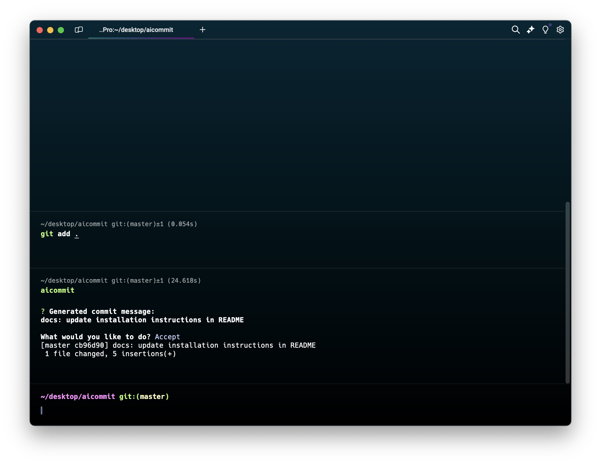

<div align="center">
  <h1>aicommit</h1>
  <p>根据 Git 暂存区变更，用 AI 生成 Conventional Commits 提交信息和分支名的轻量 CLI。</p>
  <p>
    <a href="https://www.npmjs.com/package/unique-aicommit"></a>
    <a href="https://www.npmjs.com/package/unique-aicommit"></a>
    = 18" />
  </p>
  <p><a href="./README.md">English</a> | <strong>简体中文</strong></p>
</div>

<div align="center">
  
</div>

## 快速开始

需要 Node.js >= 18。

```sh
# 1. 全局安装
npm install -g unique-aicommit

# 2. 配置任意支持的 Provider 和 API Key（也可直接用环境变量）
aicommit config set AI_PROVIDER=deepseek
aicommit config set DEEPSEEK_KEY=<your_api_key>

# 3. 暂存更改并生成提交信息
git add .
aicommit
```

## 用法

### 生成 Commit 信息

```sh
git add <files...>
aicommit

# 跳过交互确认直接提交
aicommit -y
```

交互菜单支持：
- **Accept**：直接执行 `git commit`
- **Edit**：在生成结果基础上编辑后提交
- **Regenerate**：重新生成一条
- **Cancel**：取消本次提交

### 生成并切换分支

```sh
aicommit branch
# 简写
aicommit b
```

选择前缀（`feat` / `fix` / `docs` / `chore` / `refactor` / `none`）后预览完整分支名，确认即可自动 `git checkout -b`。

## 支持的 Providers

未在 `~/.aicommitrc` 中设置 Key 时，会自动读取对应环境变量；未设置 `AI_PROVIDER` 时会自动识别已配置 Key 的 Provider。

| Provider | 默认模型 | 配置项 | 环境变量 | 获取 Key |
|----------|----------|--------|----------|----------|
| `deepseek` | `deepseek-chat` | `DEEPSEEK_KEY` | `DEEPSEEK_API_KEY` | [DeepSeek](https://platform.deepseek.com/) |
| `moonshot` | `moonshot-v1-8k` | `MOONSHOT_KEY` | `MOONSHOT_API_KEY` | [Moonshot](https://platform.moonshot.cn/) |
| `siliconflow` | `Qwen/Qwen2.5-7B-Instruct` | `SILICONFLOW_KEY` | `SILICONFLOW_API_KEY` | [SiliconFlow](https://cloud.siliconflow.cn/) |
| `openai` | `gpt-4o-mini` | `OPENAI_KEY` | `OPENAI_API_KEY` | [OpenAI](https://platform.openai.com/api-keys) |
| `openrouter` | `openai/gpt-4o-mini` | `OPENROUTER_KEY` | `OPENROUTER_API_KEY` | [OpenRouter](https://openrouter.ai/keys) |
| `gemini` | `gemini-2.0-flash` | `GEMINI_KEY` | `GEMINI_API_KEY` / `GOOGLE_API_KEY` | [Google AI Studio](https://aistudio.google.com/apikey) |
| `groq` | `llama-3.3-70b-versatile` | `GROQ_KEY` | `GROQ_API_KEY` | [Groq](https://console.groq.com/keys) |
| `anthropic` | `claude-3-5-haiku-latest` | `ANTHROPIC_KEY` | `ANTHROPIC_API_KEY` | [Anthropic](https://console.anthropic.com/settings/keys) |
| `ollama` | `llama3.2` | 无需 Key | - | [Ollama](https://ollama.com/) |

### 使用本地 Ollama（无需 API Key）

```sh
aicommit config set AI_PROVIDER=ollama
aicommit config set AI_MODEL=llama3.2
```

### 使用自定义 OpenAI 兼容接口（OneAPI / LM Studio / 中转站）

```sh
aicommit config set AI_BASE_URL=https://api.example.com/v1
aicommit config set AI_MODEL=<model_name>
```

## 配置管理

配置保存在 `~/.aicommitrc`（文件权限 `0600`）。

```sh
aicommit config list                     # 查看当前生效配置（Key 自动脱敏）
aicommit config get <key>                # 读取单项配置
aicommit config set <key>=<value>        # 设置配置
aicommit config unset <key>              # 删除配置
```

常用配置项：
- `AI_PROVIDER`：当前 Provider（切换时会自动更新为该 Provider 的默认模型）
- `AI_MODEL`：覆盖默认模型名
- `AI_BASE_URL`：覆盖默认接口地址
- `AI_LOCALE`：commit 描述语言（默认 `en`，设为 `zh` 生成英文前缀 + 中文描述）
- `MAX_DIFF_CHARS`：发送给模型的最大 diff 字符数（默认 `32000`）

## 开发与测试

```sh
npm test
```

## License

ISC · Inspired by [aicommits](https://github.com/Nutlope/aicommits)
